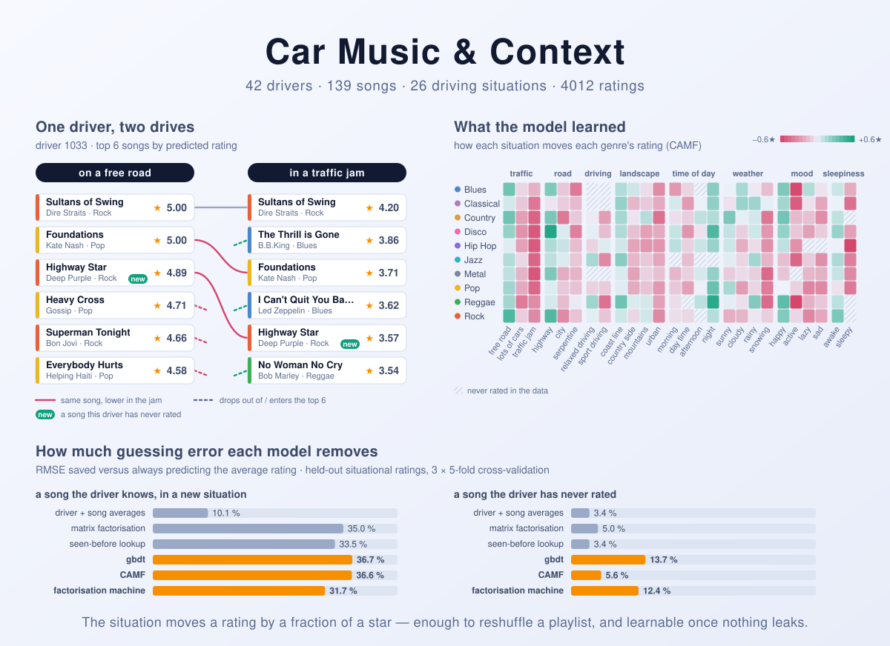

Car Music Recommender
=====================

A song that is perfect on an empty coast road can be unbearable in a traffic
jam. That is the premise of InCarMusic, a small dataset collected in 2011 for
an in-car recommender. Forty-two people rated each song several times: once
with no situation in mind, and then in three or more imagined ones, such as a
traffic jam, a sleepy night drive, a serpentine road or a sad mood. The
question is whether a recommender can learn how the drive changes the rating,
and use that to reorder the playlist.

The first version of this repository (2019) answered yes, with an F1-score of
0.79. That number turned out to measure something else. One feature copied
onto the invented "negative" examples gave the label away, and every
situation had been averaged out of the data before any model saw it. This
version starts again:

* an evaluation protocol that cannot leak,
* the 2019 gradient-boosting idea rebuilt so that it predicts what it claims
  to,
* two alternatives from the context-aware recommender literature,
* baselines, so every number has something to be compared with.

The answer is smaller than 0.79, and more interesting. A situation moves a
rating by a fraction of a star, enough to reorder a driver's top five. Knowing
the situation helps most with songs the driver has never rated: there, the
best model cuts the error of a context-free recommender by 8%.

<picture>
  <source media="(prefers-color-scheme: dark)" srcset="docs/banner-dark.svg">
  
</picture>

*(The banner is not decoration. Every part of it comes from the code in this
repository:*

* *The two playlists are what `carmusic recommend` returns for driver 1033
  with the default model.*
* *The heat map is what CAMF learned from all 4,012 ratings: the shift of the
  situation itself plus the shift for that genre in that situation.*
* *The bars are the cross-validation results in the tables below.)*

## Problem definition

A car knows a few things about the current drive:

* the traffic,
* the road type,
* the landscape,
* the time of day,
* the weather,
* whether the driving is relaxed or sporty,
* how the driver feels: their mood and whether they are awake or sleepy.

Given a driver and one such **situation**, rank the songs in the catalogue so
that the songs this driver would rate highest *in this situation* come first.

Formally, learn `r̂(driver, song, situation)` on the 0–5 rating scale. Judge it
in two ways:

* how close the predicted ratings are (MAE, RMSE),
* how well they order the songs that one driver rated in one situation (nDCG,
  pairwise accuracy).

## The data

`data/Data_InCarMusic.xlsx` is the dataset of Baltrunas et al. (2011), as
redistributed by [CARSKit](https://github.com/irecsys/CARSKit). It holds:

| | |
|---|---|
| ratings | 4,012 (0–5 stars) |
| drivers | 42 |
| songs | 139, in 10 genres; 82 of them are pop |
| situations | 26 conditions in 8 dimensions |
| ratings per driver | 4 to 832 (median 40) |

The structure of the experiment is what matters most for modelling:

* **Every rating has at most one situation.** 1,003 ratings were given with no
  situation and 3,009 in exactly one, such as *"Imagine that you ended up in a
  traffic jam"*.
* **Every (driver, song) pair is rated more than once.** Each of the 930 pairs
  has a no-context rating plus three or more situational ones. More than half
  (54%) of the situational ratings equal the same pair's no-context rating, and
  the two correlate at 0.75. So "what did they give it before" is a very strong
  predictor, and any honest evaluation has to say whether it was available.
* **The shifts are real but small.** Compared with the same pair's no-context
  rating, the average situational rating moves between −0.45 stars (*sad*) and
  +0.29 (*night*). *Traffic jam*, *sleepy* and *lots of cars* push ratings
  down; *free road*, *highway* and *coast line* lift them.

## Requirements

**Python 3.11 or newer** (tested on 3.13), with `numpy`, `pandas`,
`scikit-learn` (1.7 or newer) and `openpyxl`. There is no GPU, deep-learning
framework or AutoML stack to install. Every model here trains in seconds on a
laptop CPU.

```shell
python -m venv .venv
.venv/bin/pip install -e ".[dev]"      # the package, plus pytest and ruff
```

## Running it

```shell
carmusic situations                                       # the 26 situations, by dimension
carmusic recommend --user 1033 --situation "traffic jam"  # top 5 songs (-k to change)
carmusic evaluate                                         # both protocols, 5-fold, ~70 s
carmusic evaluate --repeats 3                             # what the tables below report, ~3.5 min
pytest                                                    # 28 tests, ~15 s
```

`python -m carmusic` works too. Tables and playlists go to **stdout**;
progress and summaries go to **stderr**.

```
$ carmusic recommend --user 1033 --situation "free road"
 1. 4.97  Dire Straits - Sultans of Swing  [Rock]  (rated before)
 2. 4.83  Kate Nash - Foundations - Full Explicit Version  [Pop]  (rated before)
 3. 4.70  Bob Marley - No Woman No Cry  [Reggae]  (rated before)
 4. 4.65  Desmond Dekker - Israelites  [Reggae]  (rated before)
 5. 4.63  Gossip - Heavy Cross - Album Version  [Pop]  (rated before)

$ carmusic recommend --user 1033 --situation "traffic jam"
 1. 4.06  Dire Straits - Sultans of Swing  [Rock]  (rated before)
 2. 3.57  Jimi Hendrix - Purple Haze  [Rock]  (rated before)
 3. 3.40  Kate Nash - Foundations - Full Explicit Version  [Pop]  (rated before)
 4. 3.36  B.B.King - The Thrill is Gone  [Blues]  (rated before)
 5. 3.34  Bon Jovi - Superman Tonight - Album Version  [Rock]  (rated before)
```

In the jam every song loses about a star, and the order changes too: rock and
blues climb past reggae and pop.

Options for `recommend`:

| Flag | Meaning |
| --- | --- |
| `--user ID` | The driver, `1001`–`1042`. |
| `--situation NAME` | One of `carmusic situations`, or `none`. |
| `-k N` | How many songs to list (default 5). |
| `--model NAME` | `gbdt` (default), `camf`, `fm`, or any baseline. |

`evaluate` also takes:

| Flag | Meaning |
| --- | --- |
| `--protocol` | `new-situation`, `new-song` or `both`. |
| `--models` | A comma-separated subset of models. |
| `--folds N` | Number of folds. |
| `--repeats N` | Redraw the folds `N` times. |
| `--seed N` | Random seed. |
| `--csv FILE` | Also write per-fold scores to `FILE`. |

## How it is evaluated

**Two questions, kept apart** (`src/carmusic/protocol.py`). Both use k-fold
cross-validation, and both score only situational ratings.

* **`new-situation`: a song the driver knows, in a situation they haven't
  rated it in.** A random fifth of the situational ratings is hidden. The
  driver's other ratings of those songs, including the no-context one, stay
  in training. This isolates what the situation adds.
* **`new-song`: a song the driver has never rated.** A random fifth of the
  (driver, song) *pairs* is hidden, with every rating of each pair. This is the
  real recommendation case.

**Four metrics** (`src/carmusic/metrics.py`):

* **MAE** and **RMSE** of the predicted rating.
* **nDCG@10** and **pairwise accuracy**, computed *within one driver and one
  situation*. That is the list a car would actually show, and an effect that
  lowers every song equally doesn't change it. Pairwise accuracy reads plainly:
  of two songs the same driver rated differently in the same situation, how
  often is the better one ranked first? 0.5 is a coin flip.
* Tied predictions count as the average over all tie orders (McSherry & Najork,
  2008). A constant predictor therefore scores exactly 0.5, not whatever order
  the rows were stored in.

**Nothing is tuned on a test fold.** Each model chooses its own settings on a
validation slice of its training data that asks the same question as the
protocol (`holdout()`): its penalty strength, or for `gbdt` its number of
trees. For the deployed `recommend`, which must handle known and new songs
alike, the slice mixes both.

## The three solutions

All three predict the rating in context. They share an interface
(`fit` / `predict` / `score`) and a seed, so they are directly comparable and
deterministic.

### 1. `gbdt`: the 2019 model, corrected

The 2019 solution was a gradient-boosted classifier, and the idea of a tree
ensemble over hand-made features is a reasonable one. `src/carmusic/models/gbdt.py`
keeps it and fixes the parts that made it unsound:

* **The target is the rating, in its situation.** There is no averaging across
  situations and no invented negatives; the data has 1,610 real ratings of 0
  or 1 stars.
* **No feature ever sees its own row's rating.** Driver, song and situation
  statistics are *cross-fitted*, as in target encoding: each training row gets
  them from the other folds, and a test row from the whole training set. A
  unit test changes one rating and checks that its row's features stay the
  same.
* **Known and new songs are both learned.** "What did this driver give this
  song before" is the strongest single clue, but it only exists for a song the
  driver has rated. So every training row is encoded twice: once with the
  folds drawn by row (the song is known), and once with the folds drawn by
  whole (driver, song) pairs (the song is new and the pair features are
  missing). The trees learn both regimes. At prediction time, a missing pair
  feature sends a row down the "new song" branches.
* **Context enters as shifts.** A shift is how much a situational rating
  differs from the same pair's no-context rating. Shifts are averaged per
  situation, per genre × situation, per song × situation and per driver ×
  situation, and each finer average is shrunk toward the coarser one.
* **Monotone where common sense says so.** A higher previous rating, or a more
  favourable situation, can never lower a prediction. scikit-learn's
  `HistGradientBoostingRegressor` enforces this with `monotonic_cst`, and also
  handles the categorical genre and situation natively.

### 2. `camf`: context-aware matrix factorisation

This is the model the dataset's own authors proposed (Baltrunas, Ludwig &
Ricci, 2011), in `src/carmusic/models/camf.py`:

```
r̂(u, i, c) = μ + b_u + b_i + B_c + B_genre(i),c + B_i,c + p_u · q_i
```

`p_u · q_i` is ordinary matrix factorisation: the driver's taste matched
against the song's character. The situation adds three additive shifts, from
coarse to fine:

* `B_c`, for the situation itself ("everything is worse in a traffic jam"),
* `B_genre,c`, for a genre in that situation ("blues suffers when you feel
  active"),
* `B_i,c`, for one song in that situation.

The finer terms have few ratings each, and an L2 penalty keeps them at zero
unless the data insists. These are the paper's CAMF-CI and CAMF-CC variants
combined. The heat map in the banner is `B_c + B_genre,c`: one interpretable
number per genre and situation.

### 3. `fm`: a factorisation machine

Rendle et al. (2011) treat every rating as a sparse vector of four one-hot
fields, driver, song, genre and situation, and model every pair of them with a
dot product of latent vectors (`src/carmusic/models/fm.py`):

```
r̂ = μ + Σ biases + Σ over the 6 field pairs ⟨v_a, v_b⟩
```

What it adds over CAMF is **driver × situation**. CAMF assumes a traffic jam
shifts a song the same way for everyone. The FM can learn that it is *this*
driver who reaches for rock in a jam. Because every interaction is low-rank,
a combination never seen in training still gets an estimate from its parts.

CAMF, FM and the matrix-factorisation baselines are all one small numpy
engine, `FactorModel` in `src/carmusic/models/factor.py`. A model is just a
declaration of which fields get biases and which pairs interact. Training is
full-batch Adam on squared error plus an L2 penalty, with the penalty chosen
per fit on the validation slice.

### Baselines

| model | what it predicts |
|---|---|
| `global-mean` | the average rating, always |
| `biases` | average + how generous the driver is + how well-liked the song is |
| `mf` | biased matrix factorisation (Koren et al., 2009), trained on every rating with the situation ignored: the context-free reference |
| `seen-before` | whatever this driver gave this song before, in any situation; for a new song, the `biases` prediction |

## Results

`carmusic evaluate --repeats 3`: 5-fold cross-validation, redrawn three times,
so each cell is the mean ± standard deviation over 15 folds. Every model sees
the same folds. **beats mf** counts the folds in which a model's RMSE is lower
than that of context-free matrix factorisation on the same split.

**A song the driver knows, in a new situation** (`new-situation`)

| model | MAE | RMSE | nDCG@10 | pair acc. | beats mf |
|---|---:|---:|---:|---:|---:|
| global-mean | 1.304 ± 0.023 | 1.477 ± 0.023 | 0.816 ± 0.008 | 0.500 ± 0.000 | 0/15 |
| biases | 1.103 ± 0.041 | 1.323 ± 0.035 | 0.893 ± 0.013 | 0.715 ± 0.032 | 0/15 |
| mf | 0.673 ± 0.027 | 0.952 ± 0.034 | 0.956 ± 0.008 | 0.890 ± 0.017 | - |
| seen-before | 0.638 ± 0.025 | 0.982 ± 0.032 | 0.956 ± 0.010 | 0.888 ± 0.021 | 0/15 |
| **gbdt** | 0.678 ± 0.031 | **0.929** ± 0.032 | 0.956 ± 0.007 | 0.885 ± 0.023 | 14/15 |
| **camf** | 0.683 ± 0.024 | **0.930** ± 0.032 | **0.959** ± 0.006 | 0.886 ± 0.020 | 14/15 |
| **fm** | 0.758 ± 0.026 | 0.991 ± 0.032 | 0.950 ± 0.009 | 0.872 ± 0.022 | 1/15 |

**A song the driver has never rated** (`new-song`)

| model | MAE | RMSE | nDCG@10 | pair acc. | beats mf |
|---|---:|---:|---:|---:|---:|
| global-mean | 1.303 ± 0.034 | 1.477 ± 0.034 | 0.818 ± 0.007 | 0.500 ± 0.000 | 0/15 |
| biases | 1.217 ± 0.025 | 1.429 ± 0.030 | 0.848 ± 0.013 | 0.587 ± 0.039 | 1/15 |
| mf | 1.184 ± 0.032 | 1.388 ± 0.039 | 0.863 ± 0.016 | 0.633 ± 0.042 | - |
| seen-before | 1.217 ± 0.025 | 1.429 ± 0.030 | 0.848 ± 0.013 | 0.587 ± 0.039 | 1/15 |
| **gbdt** | 1.050 ± 0.044 | **1.276** ± 0.050 | **0.887** ± 0.014 | **0.688** ± 0.046 | 15/15 |
| **camf** | 1.164 ± 0.031 | 1.374 ± 0.040 | 0.871 ± 0.015 | 0.645 ± 0.047 | 15/15 |
| **fm** | **1.046** ± 0.046 | 1.292 ± 0.049 | 0.885 ± 0.013 | 0.684 ± 0.042 | 15/15 |

What the tables say:

* **Context helps, modestly, and consistently.** For known songs, `gbdt` and
  `camf` cut RMSE from 0.952 to 0.93 (−2.4%), and do so on 14 of 15 splits.
  For new songs, `gbdt` and `fm` cut it from 1.388 to 1.276 and 1.292 (−8%
  and −7%) on every split. They also rank better there, with pairwise accuracy 0.69
  against 0.63.
* **For a known song, memory beats modelling on MAE.** `seen-before` has the
  lowest MAE (0.638), because more than half of situational ratings repeat
  the old rating exactly and MAE rewards exact hits. The context-aware models
  win on RMSE: they avoid the large misses when a situation really does
  change the answer.
* **Ordering a driver's known songs within one situation is already almost
  solved without context.** `mf` reaches 0.89 pairwise accuracy, and no
  context-aware model improves on it. Here the situation mostly moves the
  *level* of a rating, the same for every song.
* **No single winner.** `camf`, the dataset authors' design, is the best
  choice for known songs: it is simple and interpretable, and ties `gbdt`.
  `fm` is good at new songs but worse than plain MF at known ones, because one
  shared vector per field has to serve six interactions. `gbdt` is the only
  model in the top group on both questions, so `carmusic recommend` uses it by
  default.
* **This is a hard problem.** On a new song, even the best model is off by
  more than a star on average. The data is 42 people imagining situations
  they were not in, mostly rating pop.

## What was wrong with the 2019 version

The original notebooks are kept unchanged in [`legacy/`](legacy/). Each problem
below was checked against them.

1. **The context was averaged away.** The exploratory notebook aggregated all
   ratings of a (driver, song) pair into one row, summing the situation
   columns. Every one of the 930 rows therefore claims three or more
   situations at once. The modelling notebooks trained on that table. The
   Spotlight notebook also tried the raw ratings, but with no context
   columns at all. So none of them could learn anything about a particular
   situation.
2. **"Liked" meant "rated".** The classifier's positive label was every pair
   the driver had rated, whatever the rating. 41% of those "liked" pairs
   average below 2 stars out of 5.
3. **The invented negatives were partly real.** Each negative paired a driver
   with a random song, excluding only the one song of the positive row. In a
   re-run, 47% of the "negatives" were songs that driver had in fact rated.
4. **One feature leaked the label.** `genre_ratio`, the share of the driver's
   ratings in *the positive song's genre*, was copied unchanged onto the
   invented negative row, whose song has another genre. That mismatch reveals
   the label. With `genre_ratio` and the song's genre alone, the same
   classifier scores F1 **0.785**, about the 2019 headline of 0.79. With every
   feature except `genre_ratio`, it scores **0.437**, worse than a coin flip
   on a balanced set. `python legacy/check_2019_leak.py` reproduces these
   numbers in a few seconds.
5. **The reported score was the best of many tries, on the same data.** The
   0.790 is the cross-validated F1 of the best of 250 randomly searched
   configurations, scored on the same folds used to pick it. The per-driver
   features had been computed on the full dataset before any split. The TPOT
   run (0.796) did keep a test split, but it inherits the leak in point 4.
   Neither result was compared with a baseline.
6. **The recommenders were mis-sized.** The LightFM model used 2,000 latent
   dimensions for 42 drivers and 139 songs.
7. **The stack has rotted.** Python 3.6, unpinned requirements, and libraries
   that are unmaintained or have changed their API:
   * `spotlight`, which was never published on PyPI and is no longer
     maintained,
   * the TPOT 0.x API,
   * `eli5`,
   * `pandas-profiling`,
   * `DataFrame.append`,
   * `loss='deviance'`.

The F1 of 0.79 should be read as an artefact, not as evidence that the 2019
model could recommend music.

## Other ways to solve it

* **Contextual pre-filtering and item splitting.** Instead of modelling
  context, split a song into "song in a traffic jam" and "song elsewhere"
  whenever its ratings differ significantly between the two, then run a
  context-free recommender on the split items. Baltrunas & Ricci (2009)
  introduced item splitting on this kind of data. It is simple and
  explainable, but with three situational ratings per pair few splits
  survive a significance test.
* **Learning to rank.** LambdaMART (e.g. LightGBM's `lambdarank`) can optimise
  the order within (driver, situation) lists directly. The lists here are
  short (a median of two rated songs per driver and situation), which leaves
  little for a listwise loss to work with.
* **Field-aware or neural factorisation machines.** FFM (Juan et al., 2016)
  gives each field a separate vector per partner field, which would remove
  `fm`'s weakness on known songs. DeepFM-style models add an MLP on top. With
  4,012 ratings, both risk fitting noise.
* **Contextual bandits.** A real car would learn from skips and replays, not
  from a survey. LinUCB (Li et al., 2010) and Thompson sampling choose the next
  song while balancing what is known against what could be learned. They
  cannot be evaluated honestly on InCarMusic, which has no logged decisions,
  but they are the natural next step once a recommender is deployed.

## Project layout

```
src/carmusic/
  data.py            load the Excel file into one tidy ratings table
  protocol.py        the two evaluation protocols, plus the validation split models tune on
  metrics.py         MAE, RMSE, tie-aware nDCG, pairwise accuracy
  evaluate.py        repeated k-fold cross-validation, Markdown tables
  recommend.py       a ranked playlist for one driver in one situation
  cli.py             `carmusic evaluate | recommend | situations`
  models/
    base.py          the RatingModel interface
    factor.py        the bias + latent-factor engine behind biases, mf, camf, fm
    baselines.py     global-mean, biases, mf, seen-before
    gbdt.py          solution 1, the corrected 2019 model
    camf.py          solution 2
    fm.py            solution 3
tests/               data, protocols, metrics, leakage, models, CLI
data/                Data_InCarMusic.xlsx and the dataset's citation
docs/                banner-light.svg, banner-dark.svg
legacy/              the 2019 notebooks, their outputs, and check_2019_leak.py
```

## History

The first version (2019) was a set of Jupyter notebooks:

* an exploratory analysis with clustering and association rules,
* a deep recommender with Spotlight,
* a LightFM hybrid,
* a scikit-learn classifier,
* a TPOT AutoML search,

all on Python 3.6. They now live in `legacy/`, untouched apart from the move.

The 2026 refresh made these changes:

* replaced the notebooks with a tested Python package and a CLI,
* rebuilt the data pipeline so that no situation is averaged away,
* defined two evaluation protocols that cannot leak,
* found and documented the leak behind the 2019 score,
* rebuilt the gradient-boosting model to predict ratings in context,
* added CAMF and a factorisation machine as alternatives, with baselines,
* dropped every dependency beyond numpy, pandas, scikit-learn and openpyxl.

## Literature

**The dataset**

* L. Baltrunas, M. Kaminskas, B. Ludwig, O. Moling, F. Ricci, A. Aydin,
  K.-H. Lüke, R. Schwaiger, *InCarMusic: Context-Aware Music Recommendations
  in a Car*, E-Commerce and Web Technologies (EC-Web), Springer LNBIP 85
  (2011), 89–100. This is the source of the data and of its
  "imagine that…" questionnaire. See `data/ReadMe.txt` for the BibTeX.
* Y. Zheng, B. Mobasher, R. Burke, *CARSKit: A Java-Based Context-Aware
  Recommendation Engine*, IEEE ICDM Workshops (2015). The toolkit that
  redistributes InCarMusic and benchmarks context-aware recommenders on it.

**Context-aware recommendation**

* G. Adomavicius, A. Tuzhilin, *Context-Aware Recommender Systems*, in
  *Recommender Systems Handbook*, Springer (2011), 217–253. The standard
  taxonomy: pre-filtering, post-filtering and contextual modelling. All three
  solutions here are contextual modelling.
* L. Baltrunas, B. Ludwig, F. Ricci, *Matrix Factorization Techniques for
  Context Aware Recommendation*, ACM RecSys (2011), 301–304. Introduces CAMF.
* L. Baltrunas, F. Ricci, *Context-Based Splitting of Item Ratings in
  Collaborative Filtering*, ACM RecSys (2009), 245–248. Item splitting.
* S. Rendle, Z. Gantner, C. Freudenthaler, L. Schmidt-Thieme, *Fast
  Context-Aware Recommendations with Factorization Machines*, ACM SIGIR (2011),
  635–644. S. Rendle, *Factorization Machines*, IEEE ICDM (2010).
* Y. Koren, R. Bell, C. Volinsky, *Matrix Factorization Techniques for
  Recommender Systems*, IEEE Computer 42(8) (2009), 30–37. The biased MF
  baseline.
* Y. Juan, Y. Zhuang, W.-S. Chin, C.-J. Lin, *Field-aware Factorization
  Machines for CTR Prediction*, ACM RecSys (2016).
* L. Li, W. Chu, J. Langford, R. E. Schapire, *A Contextual-Bandit Approach to
  Personalized News Article Recommendation*, WWW (2010). LinUCB.

**Evaluation and leakage**

* S. Kaufman, S. Rosset, C. Perlich, *Leakage in Data Mining: Formulation,
  Detection, and Avoidance*, ACM TKDD 6(4) (2012). Point 4 above is a textbook
  case.
* D. Micci-Barreca, *A Preprocessing Scheme for High-Cardinality Categorical
  Attributes in Classification and Prediction Problems*, SIGKDD Explorations
  3(1) (2001). Shrunk target statistics, which `gbdt` cross-fits.
* K. Järvelin, J. Kekäläinen, *Cumulated Gain-Based Evaluation of IR
  Techniques*, ACM TOIS 20(4) (2002). nDCG.
* F. McSherry, M. Najork, *Computing Information Retrieval Performance
  Measures Efficiently in the Presence of Tied Scores*, ECIR (2008).
  Tie-aware nDCG.

## License

MIT, see [LICENSE](LICENSE). The InCarMusic data belongs to its authors; cite
Baltrunas et al. (2011) when you use it.
